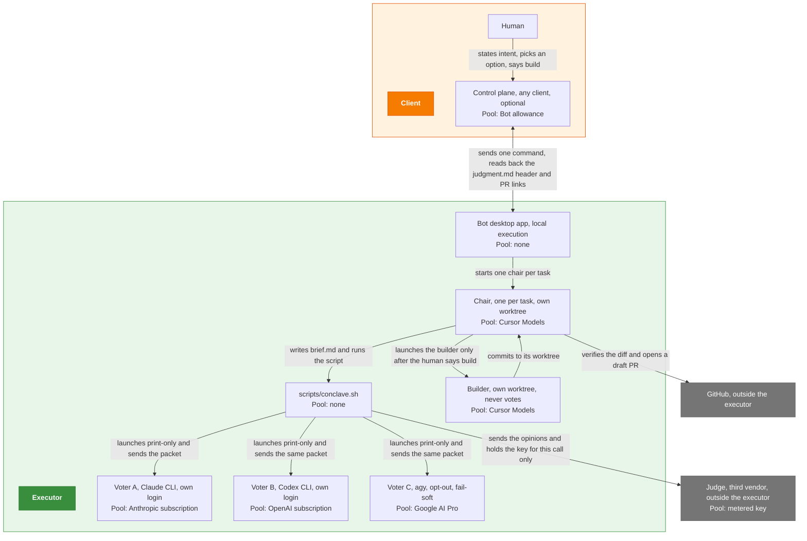
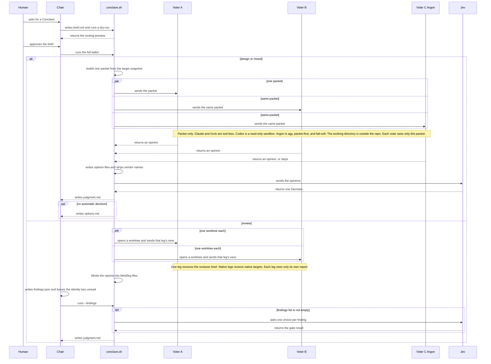
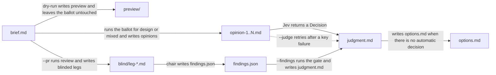

# Conclave

One brief goes to voters on separate vendors. The kind decides what those voters see, a judge returns one result, and a human decides what happens next.

`scripts/conclave.sh` can update this clone from GitHub before each run. This is off by default; set `CONCLAVE_AUTO_UPDATE=1` to turn it on.

## Architecture

The chair runs `scripts/conclave.sh` on the executor and does not judge. The builder runs only after the human says to build. The default ballot is every available leg from the lineup. Design excludes nobody. Review and mixed exclude the vendor that built the diff. Audit excludes that vendor when the brief names the author. On review, the two voters come from `seat-usage --route lineup --kind review`. `--voters` replaces that route. A missing, failed, or asking route falls back to Fable and Astra and warns. Opus native still runs when `--voters` names it, and its agreement with Fable is one vote. A capped pool is not seated. `--voters` replaces the lineup. On design and mixed, Conclave also seats Argon, a third voter leg via `agy` on the Google AI Pro subscription, unless `CONCLAVE_ARGON=0`. The lineup does not seat it. A missing `agy`, a failed usage check, a 0% Argon pool, or a bad answer skips that leg and the run continues. The resolver picks model IDs at run time.



Who starts whom, and which pool each process bills. No arrow means no channel.

## How one ticket runs

The chair writes `brief.md`, a dry-run returns the routing preview, and the full run branches once on kind.



The brief reaches the voters, the kind decides what they see, and each path ends in its own file.

## Kinds

`kind:` in the brief, or `--kind`, is `design`, `review`, `mixed`, or `audit`. The script infers `design` only, and `--pr`, `--base`, or `--head` selects review. It stops when the kind is still unclear. `kind: audit` is never inferred.

| Kind | What voters see | What the run writes |
|---|---|---|
| `design` | One shared packet outside the repo. Claude and Grok are tool-less. Codex is a read-only sandbox, which is not a full filesystem jail. | Opinion files, then a Jev Decision in `judgment.md`. `options.md` when the decision is no automatic decision. `--judge` re-runs that Decision on the existing opinions. |
| `review` | One worktree per voter. The Anthropic leg receives the reviewer brief. Native legs receive native targets. The script blinds the reports. | The chair writes `findings.json`. `--findings` writes `judgment.md`. An empty findings list writes that file with no Jev call. |
| `mixed` | The same packet path as `design`, including the target snapshot. | The same Decision path as `design`: `judgment.md`, and `options.md` when there is no automatic decision. `--judge` re-runs it. |
| `audit` | One worktree per voter, every leg on the same brief. The script snapshots the target. Legs have tools and live web access. | `--findings` writes `judgment.md` for content and claims. A proposal uses `--verdicts`. |

The chair fills `options.md` from the opinions. The human picks a row. A `judgment.md` file does not authorize building or posting.

Ask mode is not a kind. `--ask TEXT`, or `--template NAME --input FILE`, puts one prompt to each named voter, tool-less, and writes the answers side by side with a blinded copy. It needs no brief and runs no ballot. A plain question takes its voters from `seat-usage --route ask`. Jev picks the effort lean and does not rank the answers. The `cold-read` and `tell-scan` templates are the writing checks. See `docs/review.md`, "Ask mode".

Design and mixed seat Argon beside the lineup unless `CONCLAVE_ARGON=0` (`COUNCIL_ARGON` is the alias). `--voters` wins. Review and audit do not seat it. `agy` must be signed in. Do not opt in to data sharing, and do not mark the repo trusted in `agy`. The leg is fail-soft: a skip writes `voter-argon.skipped` and does not fail the run.

Design and mixed can run a Muse Wonder shadow leg beside the voters when `CONCLAVE_MUSE_SHADOW=1` (`COUNCIL_MUSE_SHADOW` is the alias). It is packet-first and tool-less, does not vote, and is not given to the chair or to Jev. When the leg runs, a `subscription_usage` snapshot from `muse exec --json` is stored at `~/.cache/quartermaster/muse-usage.json`. A missing snapshot or a write error leaves the run unchanged. The default ballot is the lineup: every available leg. Design excludes nobody. Review and mixed exclude the diff's builder. Audit excludes the named author. A capped pool is not seated. A pool ahead of pace still votes. The lineup seats Muse unless a Muse window is capped. `--voters` replaces that list. `--voters ...,muse` names that leg.

## Running it

Set `CONCLAVE_ROOT` to this clone. Start in the target repo, or pass `--repo DIR`. The brief and the ballot stay in this clone.

`scripts/council.sh` and every `COUNCIL_*` variable are deprecated aliases. `council.sh` runs `conclave.sh` with the same arguments. When both `CONCLAVE_*` and the matching `COUNCIL_*` variable are set, the `CONCLAVE_*` value wins, including when it is empty. Setting only the old name behaves as before. Ballot directories stay `tmp/council/`.

```sh
mkdir -p "$CONCLAVE_ROOT/tmp/council/smoke"
# write $CONCLAVE_ROOT/tmp/council/smoke/brief.md with a kind header
"$CONCLAVE_ROOT/scripts/conclave.sh" smoke --dry-run
"$CONCLAVE_ROOT/scripts/conclave.sh" smoke
```

Before every invocation, including `--dry-run`, `scripts/conclave.sh` fetches this clone and compares HEAD to its upstream (`scripts/freshness-check.sh`). Up to date: it prints the short sha and date. Behind, by default: it warns with the count and pulls nothing. With `CONCLAVE_AUTO_UPDATE=1`, behind with a clean tree: it runs `git pull --ff-only` and prints `old..new`; behind with a dirty tree, or diverged: it stops, nonzero, and pulls nothing. Fetch fails: it warns and continues, or stops when `CONCLAVE_REQUIRE_FRESH=1`. `CONCLAVE_SKIP_UPDATE_CHECK=1` bypasses the check. Test: `scripts/test-freshness.sh`.

`--dry-run` writes `preview/` and leaves the ballot untouched. Copy `tmp/council/examples/design-high-brief.md` for a first design run and pass `--difficulty low`. If `judgment.md` is missing after design or mixed, re-auth and run `--judge`. After review, run `--findings` once `findings.json` exists. Neither command launches voters. Review target flags are in `docs/review.md`. The full scratch layout is `tmp/council/README.md`.



Each command moves `tmp/council/<id>/` to its next state.

## Read next

- [`docs/routing.md`](docs/routing.md) — roles, pools, and the routing still being built.
- [`docs/review.md`](docs/review.md) — review phases, from lineup through the findings gate.
- [`docs/executor-setup.md`](docs/executor-setup.md) — vendor CLIs, logins, and the Jev key on a new executor.
- [`AGENTS.md`](AGENTS.md) — who may judge, who may build, and how another repo calls this one.
