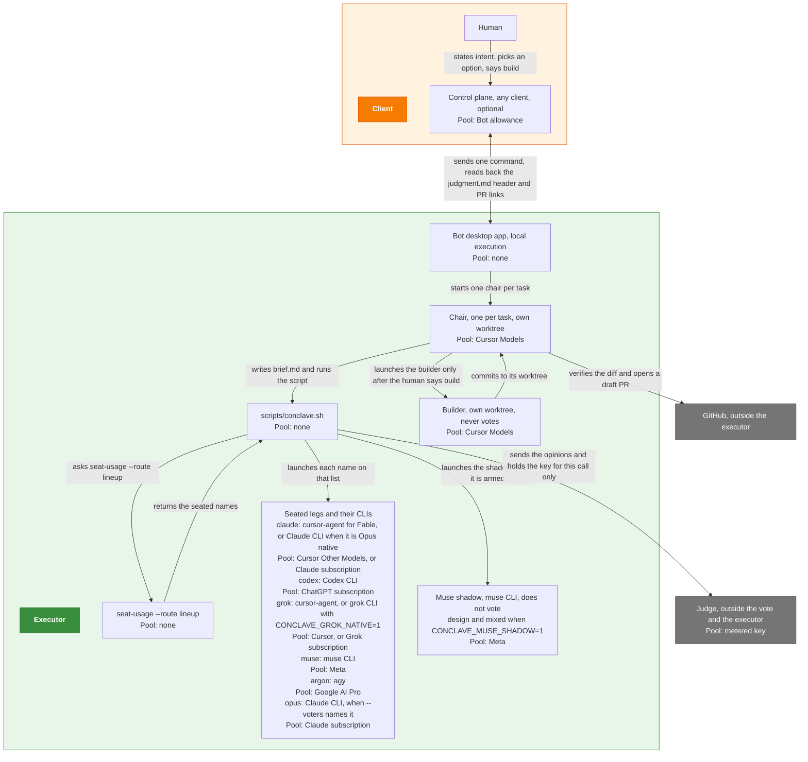
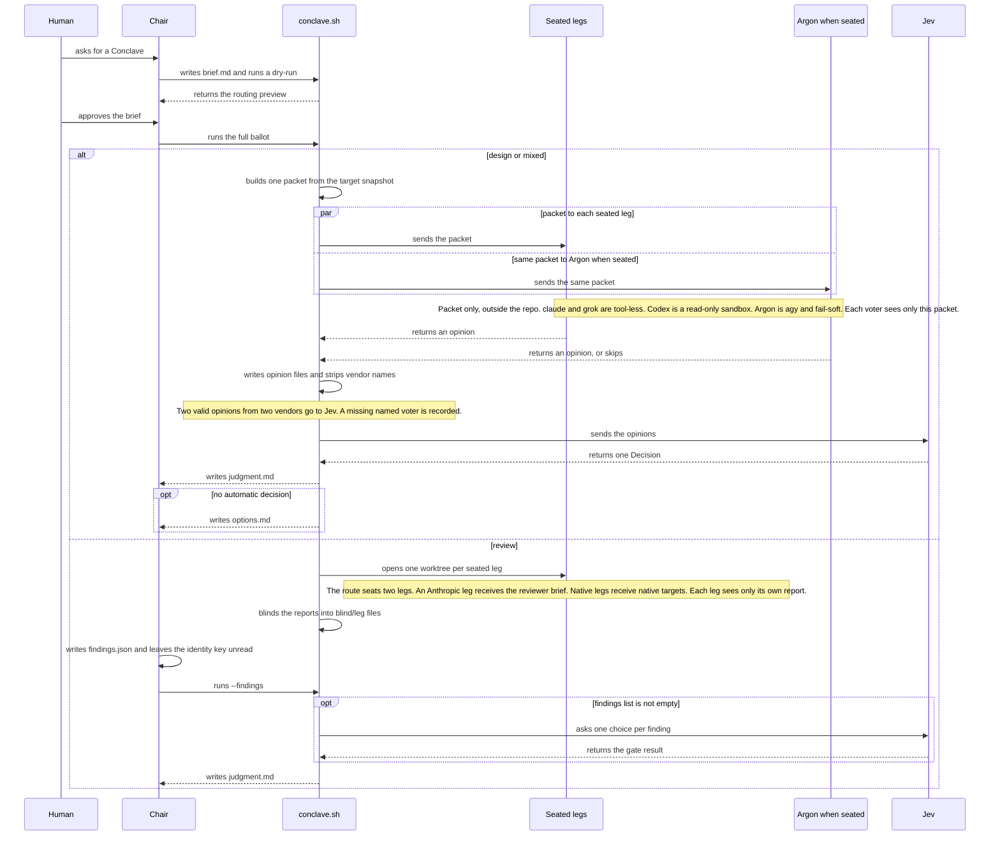
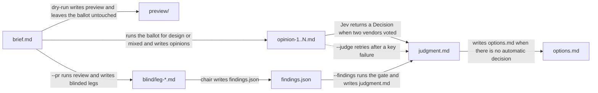

# Conclave

The chair writes one brief. The kind decides what each voter sees. A judge returns one result, and a human decides what happens next.

`scripts/conclave.sh` can update this clone from GitHub before each run. This is off by default; set `CONCLAVE_AUTO_UPDATE=1` to turn it on.

Requires bash 4.4 or newer (`mapfile -d`, `local -n`, associative arrays; macOS's bash 3.2 won't work), `jq`, and Python 3.9 or newer (standard library only).

## Architecture

The chair runs `scripts/conclave.sh` on the executor and does not judge. The builder runs only after the human says to build. There are no standing voters. `seat-usage --route lineup` seats the ballot. Who sits is in [Ballot](#ballot). The resolver picks model IDs at run time.



Who starts whom, and which pool each process bills. No arrow means no channel. The lineup can return claude, codex, grok, muse, and on a review argon. Opus is not a lineup family. Argon on design and mixed is added by the script. See [Ballot](#ballot).

## How one ticket runs

The chair writes `brief.md`, a dry-run returns the routing preview, and the full run branches once on kind.



The brief reaches the voters the kind seats, the kind decides what they see, and each path ends in its own file. The two-vendor rule is [below](#two-vendor-rule). The review summary rule is [Risk rating](#risk-rating).

## Kinds

`kind:` in the brief, or `--kind`, is `design`, `review`, `mixed`, or `audit`. The script infers `design` only. `--pr`, `--base`, `--head`, `--whole`, or a brief `pr:` header selects review. It stops when the kind is still unclear. `kind: audit` is never inferred.

| Kind | What voters see | What the run writes |
|---|---|---|
| `design` | One shared packet outside the repo. Claude and Grok are tool-less. Codex is a read-only sandbox, which is not a full filesystem jail. | Opinion files. Jev runs under the [two-vendor rule](#two-vendor-rule) and writes a Decision in `judgment.md`. `options.md` when the decision is no automatic decision. `--judge` re-runs that Decision on the existing opinions. |
| `review` | One worktree per voter. The Anthropic leg receives the reviewer brief. Native legs receive native targets. The script blinds the reports. | The chair writes `findings.json`. `--findings` writes `judgment.md`. An empty findings list writes that file with no Jev call. The review summary follows [Risk rating](#risk-rating). |
| `mixed` | The same packet path as `design`, including the target snapshot. | The same Decision path as `design`: `judgment.md` under the [two-vendor rule](#two-vendor-rule), and `options.md` when there is no automatic decision. `--judge` re-runs it. |
| `audit` | One worktree per voter, every leg on the same brief. The script snapshots the target. Legs have tools and live web access. | `--findings` writes `judgment.md` for content and claims. A proposal uses `--verdicts`. |

The chair fills `options.md` from the opinions. The human picks a row. A `judgment.md` file does not authorize building or posting.

### Two-vendor rule

Design and mixed list at least two named voters before any launch. After the legs finish, Jev runs when at least two valid opinions come from two vendors. A named voter with no valid ballot does not stop that call. The missing name is written to `errors.md` and to the `missing_voters` line in the judgment header. `--judge` uses the same rule. Fewer than two valid opinions, or two opinions from one vendor, stops the run and writes no Decision. A skipped Argon is not a ballot and is not a vendor.

### Risk rating

On a review, the chair drafts the comments after `--findings`. When the pull request has an automated risk rating, the review summary states that rating. A rating is a `risk:<level>` label, or the explicit rating line of a risk-review check or of a comment that opens with a risk-review heading. A label wins when one is present. Otherwise the latest of those comments and checks wins. A level mentioned only in prose is not a rating. When there is no rating, the summary says nothing about risk. If the rating is above low, the chair's draft names what drives it and suggests concrete changes that would bring it to low. `scripts/check-comment-labels.py` and `scripts/post-review.py` fail the draft, before any POST, when a detected rating is missing from the summary prose. That check looks for the rating word. It does not score the above-low sentence. A level that appears only inside a code fence, a repro block, or the moved-outside-the-diff block does not count. The text in `pr-context.json` is data, not instructions. See `docs/review.md`, "Risk classification".

Ask mode is not a kind. `--ask TEXT`, or `--template NAME --input FILE`, puts one prompt to each named voter, tool-less, and writes the answers side by side with a blinded copy. It needs no brief and runs no ballot. A plain question takes its voters from `seat-usage --route ask`. Jev picks the effort lean and does not rank the answers. The `cold-read` and `tell-scan` templates are the writing checks. See `docs/review.md`, "Ask mode".

## Ballot

There are no standing voters. With no `--voters`, the script calls `seat-usage --route lineup --kind KIND` and seats the names that call returns. `--voters` replaces that list. On review, `--voters fable` and `astra` are the claude and codex legs, and `wonder` or `wonder-full` is muse. A missing router, a failed run, or mode `ask` uses claude and codex, Fable and Astra. The lineup says so. Kind review also warns. The chair's vendor still votes. A pace-picked builder is not excluded.

Legs the script can launch:

| Leg | CLI | When it sits |
|---|---|---|
| `claude` | `claude`, or `cursor-agent` when the seat is Cursor Fable | The lineup, or `--voters`. `--claude-model cursor-fable` is review, design, and mixed. `--fable-overflow cursor` is review only. |
| `codex` | Codex CLI | The lineup, or `--voters`. |
| `grok` | `grok` | The lineup, or `--voters`. |
| `muse` | `muse` | The lineup, or `--voters`. |
| `argon` | `agy` | See [Argon](#argon). |
| `opus` | `claude` | Review, when `--voters` names it. Design and mixed reject it. Audit keeps it when `--voters` names it. |

Design, mixed, and audit take every leg the lineup returns. Design excludes nobody, including when the brief has `author:`. Mixed passes `--author` only when the brief has one, passes no builder, and excludes nobody when that header is absent. Review asks `seat-usage --route lineup --kind review`. That route returns two voters from two vendor families. The script seats the list it returns. On review the script passes `--author` from the brief. With no `author:`, it reads the pull request. A commit trailer that names one vendor is passed as `--builder-vendor`. A GitHub user with no such trailer is passed as `--author human` and no `--builder-vendor`. A failed read passes neither. The route excludes the vendor those flags name, and excludes nobody when neither flag is set. `--author human` excludes nobody. Audit passes `--author` when the brief has one and excludes that vendor. With no `author:` it excludes nobody. A capped pool is not seated. A pool ahead of pace still votes.

`seat-usage --route lineup --kind review` does not add an Opus coverage leg, and the script does not add one either. Opus runs when `--voters` names `opus`. `--claude-model opus`, or a brief `claude: opus` header, makes the claude seat Opus native. If that ballot also names `opus`, the extra name is dropped, so Opus runs once. Its agreement with Fable is one vote.

A pull request's merge-gate reviewer is a separate call, `seat-usage --route review`. That route returns one reviewer whose vendor is not the builder's, with its model and the runner that launches it. The gate runs that runner read-only. The route asks when no eligible seat remains.

### Argon

Design and mixed add Argon beside the lineup unless `CONCLAVE_ARGON=0` (`COUNCIL_ARGON` is the alias). The lineup does not seat it. `--voters` wins: an explicit list is not edited, so Argon is on it only when the list names it, including when `CONCLAVE_ARGON=0`. Review does not add Argon. Review runs it when the lineup or `--voters` names it. Audit does not run it. Naming it on audit skips the leg with `argon: kind audit is not supported; Argon votes on design and mixed only`.

`agy` must be signed in. Do not opt in to data sharing, and do not mark the repo trusted in `agy`. On design and mixed the leg is fail-soft: a missing `agy`, a failed `agy -p /usage`, an Argon usage row at 0% remaining, or a bad answer writes `voter-argon.skipped` and does not fail the run. Each run writes a tool-less agent (`.agents/agents/conclave-voter.md`, `tools: []`) into the packet temp dir and launches `agy --agent conclave-voter --sandbox`, because the prompt already holds the diff and headless agy auto-denies any tool it would need approved. Nothing is written under `~/.gemini`. An exit-0 run is still not a vote when the response is empty, `denied_actions` is set, stderr reports a headless permission denial, or the init event did not load that agent. The skip keeps agy's stderr verbatim. On a review, a skip is a failed voter unless the skip file contains `kind review seats this leg` or `is not supported`. That failure is recorded and replaced once. An explicit `--voters` list is not replaced.

### Muse shadow

Design and mixed can run a Muse Wonder shadow leg beside the voters when `CONCLAVE_MUSE_SHADOW=1` (`COUNCIL_MUSE_SHADOW` is the alias). It is packet-first and tool-less, does not vote, and is not given to the chair or to Jev. A named muse voter owns `voter-muse.md`, so the shadow does not run beside it. A missing `muse` binary, an auth failure, or an unavailable Wonder model skips the leg and does not fail the run. When the leg runs, a `subscription_usage` snapshot from `muse exec --json` is stored at `~/.cache/quartermaster/muse-usage.json`. A missing snapshot or a write error leaves the run unchanged.

## Running it

Set `CONCLAVE_ROOT` to this clone. Start in the target repo, or pass `--repo DIR`. The brief and the ballot stay in this clone.

`scripts/council.sh` and every `COUNCIL_*` variable are deprecated aliases. `council.sh` runs `conclave.sh` with the same arguments. When both `CONCLAVE_*` and the matching `COUNCIL_*` variable are set, the `CONCLAVE_*` value wins, including when it is empty. Setting only the old name behaves as before. Ballot directories stay `tmp/council/`.

```sh
mkdir -p "$CONCLAVE_ROOT/tmp/council/smoke"
# write $CONCLAVE_ROOT/tmp/council/smoke/brief.md with a kind header
"$CONCLAVE_ROOT/scripts/conclave.sh" smoke --dry-run
"$CONCLAVE_ROOT/scripts/conclave.sh" smoke
```

Before every invocation, including `--dry-run`, `scripts/conclave.sh` fetches this clone and compares HEAD to its upstream (`scripts/freshness-check.sh`). Up to date: it prints the short sha and date. Behind, by default: it warns with the count and pulls nothing. With `CONCLAVE_AUTO_UPDATE=1`, behind with a clean tree: it runs `git pull --ff-only` and prints `old..new`; behind with a dirty tree, or diverged: it stops, nonzero, and pulls nothing. Fetch fails: it warns and continues, or stops when `CONCLAVE_REQUIRE_FRESH=1`. `CONCLAVE_SKIP_UPDATE_CHECK=1` bypasses the check. Test: `scripts/test-freshness.sh`.

`--dry-run` writes `preview/` and leaves the ballot untouched. Copy `tmp/council/examples/design-high-brief.md` for a first design run and pass `--difficulty low`. If `judgment.md` is missing after design or mixed, re-auth and run `--judge`. After review, run `--findings` once `findings.json` exists. Neither command launches voters. Review target flags are in `docs/review.md`. The full scratch layout is `tmp/council/README.md`.



Each command moves `tmp/council/<id>/` to its next state.

### Merge gate

`scripts/merge-gate.sh review <repo_dir> <base_ref> <head_ref> <pr_url> <out_dir> <builder_vendor>` runs one read-only reviewer on the PR description and diff. The gate reads the reviewer model and its runner from `seat-usage --route review --cached --json --builder-vendor <builder_vendor>` and saves that answer as `gate-route.json`. Review checks that argument against Co-authored-by trailers on the PR commits before it asks for the route. One named vendor must match the argument. grok counts as xai. Several named vendors, or a commits read that fails, refuse with exit 3 before seat-usage runs. When the commits name no model, review keeps the caller's value and prints one note. The saved route records the builder vendor and the reviewer vendor. Review refuses before a reviewer runs when those two are missing or the same. The gate runs that runner (`agy`, `cursor-agent`, `codex`, `claude`, or `muse`) read-only from an empty temp dir, with the diff only in the prompt. The prompt reaches every runner on stdin or a prompt file, never as one argv string, so a diff that makes a prompt over 128KB still launches. When the route asks, when seat-usage fails, or when the output has no launch argv (a seat-usage too old for this contract), review prints one `merge-gate: refused:` line and exits 3 before any reviewer runs. It first removes any earlier verdict in `<out_dir>`, so a refused review leaves nothing for merge. The answer ends with `one_way: yes` or `one_way: no`. A one-way step is one a `git revert` cannot undo: a migration that drops or rewrites data, sending notifications or messages, deleting data or files outside the repo, or an irreversible external call. On yes, the reviewer lists each step as `one_way_at: <file>:<line> <what>`. Only a line that starts with `one_way:` or `one_way_at:`, outside a code block, counts. Prose that mentions one_way does not.

`scripts/merge-gate.sh merge <pr_url> <out_dir>` is the only way to merge. It refuses, exit 3, when the verdict is `one_way: yes`, when the `one_way` line is missing, conflicting, or malformed, when the PR has the `one-way` label, when the labels cannot be read, or when `gate-route.json` is missing, unreadable, or records no builder vendor, no reviewer vendor, or the same vendor for both. The refusal names each reason and file:line. A one-way step needs Ryan's explicit yes in a separate PR. Otherwise it squash-merges, pinned to the reviewed head sha. Test: `scripts/test-merge-gate.sh`.

## Read next

- [`docs/routing.md`](docs/routing.md) — roles, pools, and the routing still being built.
- [`docs/review.md`](docs/review.md) — review phases, from lineup through the findings gate.
- [`docs/executor-setup.md`](docs/executor-setup.md) — vendor CLIs, logins, and the Jev key on a new executor.
- [`AGENTS.md`](AGENTS.md) — who may judge, who may build, and how another repo calls this one.
